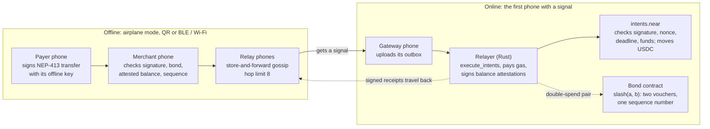

# NearBy

Offline payments between phones, settled on NEAR through [NEAR Intents](https://docs.near-intents.org).

> Pay anyone nearby, even with no signal. Settled on NEAR.

The payer signs a NEAR Intents `transfer` on their phone with no network. The merchant's phone checks it offline and takes it, by QR code or over Bluetooth / Wi-Fi ([Nearby Connections](https://developers.google.com/nearby/connections/overview) on Android, [Multipeer Connectivity](https://developer.apple.com/documentation/multipeerconnectivity) on iOS). Phones carry it hop by hop until one has a signal; that phone hands it to a relayer, which settles it on `intents.near`. A payer who signs the same payment twice loses a NEAR bond, on chain, to a contract that checks both signatures itself.

Built for the [NEAR Hackathon](https://nearhackathon.com) 2026 (tracks: Real-World Money, Open Innovation). Every commit is from 2026-11-05 to 2026-11-14 UTC; there is no pre-hackathon baseline. Mainnet only: NEAR Intents has no testnet deployment.

## Proof on mainnet

Everything below ran on mainnet on 2026-11-14 with throwaway keys. Click through: each transaction is on `intents.near` or the bond contract.

| What | Transaction |
| --- | --- |
| A 0.10 USDC voucher, signed by the test tool, settled through the relayer | [CAF2mq…](https://nearblocks.io/txns/CAF2mqAyH4t6WHX5h1qtDQrvvwhbwkQtAyQGYEz15GhQ) |
| A double-spend made with `settle-test cheat`, slashed by the bond contract: key banned, 1 NEAR bond forfeited | [7mmL3J…](https://nearblocks.io/txns/7mmL3JL7cRwQyQVv3cPQuxMHnFmtcZrTM445iSkX5uQb) |
| Two iPhones paid each other by QR code in airplane mode, once in each direction. Each voucher was signed with no relayer in reach and uploaded 35 s and 21 s later, when a phone had its signal back | [9xRH29…](https://nearblocks.io/txns/9xRH29n2pZmnTvLyX71FGpVqXbsSNysReBYMi615bz7n), [5Guouw…](https://nearblocks.io/txns/5GuouwTLSrwsu466YwsELrbFdJcsPyyBEkwL4AoVsHRm) |
| A top-up through the app's Top up button: 0.347 NEAR sent to a NEAR Intents 1Click deposit address, arriving as 1 USDC in the phone's offline balance | [SENh7o…](https://nearblocks.io/txns/SENh7o6Tum1gXeHnoyHNcjNg1EEBL3pGxMEG1jMU6D7) |

What has *not* been shown yet is listed under [Status](#status), and it matters: the radio relay between phones has only run in tests, and no voucher has waited longer than 35 seconds for a signal.

## Why this only works on NEAR Intents

An offline payment is a signed message that must still be good hours later, submitted by a stranger, in any order relative to the payer's other payments. Three properties of NEAR Intents make that possible, and each one is missing somewhere else.

| Property | What it buys an offline payer | Elsewhere |
| --- | --- | --- |
| **Unordered nonces.** An Intents nonce is 32 random bytes; the contract only checks it was never used | Sign ten payments offline, in a shop, a bus and a market. They settle in whatever order the phones carrying them reach the internet. One lost voucher stalls nothing | An Ethereum EOA's nonce must increase by one, so payment 3 cannot settle before payment 2. A Solana transaction expires with its recent blockhash in about a minute; durable nonces need one on-chain account per outstanding payment. A plain NEAR transaction has the same problem: an access key's nonce must strictly increase. That is why vouchers are intents, not transactions |
| **Signed messages, not transactions** ([NEP-413](https://github.com/near/NEPs/blob/master/neps/nep-0413.md)). `execute_intents` takes a signed intent from *anyone* who holds it; the signature alone authorizes the transfer | The payer needs no gas, no network and no account on the relayer. The relayer is a courier that pays gas and holds nothing: any phone, or the merchant, could call `execute_intents` instead. The protocol's own `deadline` expires stale vouchers, and `recipient = intents.near` stops replay anywhere else | A meta-transaction relayer on most chains is a trusted contract with its own nonce scheme, or a custodian |
| **An account is a key.** A NEAR implicit account is the hex of its ed25519 public key | The offline wallet exists the moment the phone makes a key: no transaction, fee or server. The merchant verifies the payer's identity offline from the voucher alone, and `env::ed25519_verify` lets the bond contract check both signatures of a double-spend on chain | An EVM smart account exists only after a deployment transaction; an EOA exists for free but cannot sign unordered payments (first row) |

Two more things fall out of settling through Intents rather than a contract of our own. The relayer never touches funds, so a bug or a rogue operator can at worst delay a payment (vouchers can be submitted by anyone else). And a merchant's USDC lands inside `intents.near`, where the same 1Click service the app uses for top-ups can turn it into any asset Intents supports, so cashing out to another chain needs no code from us.

## How it works



1. **Onboard (online, once).** The app makes an ed25519 key held only on the phone; its NEAR implicit account (the hex of the key) exists with no transaction. Two things are then put behind that account, in two currencies, and only the first happens in the app:
   - *The budget: USDC inside `intents.near`.* The Top up button asks NEAR Intents' swap service (1Click) for a deposit address, and NEAR sent there from any wallet or exchange arrives as USDC in the phone's balance about half a minute later. A swap that fails credits the NEAR back to the phone's account inside `intents.near`, where the app cannot spend it yet. Nothing is locked: vouchers draw on this deposit.
   - *The bond: NEAR in the bond contract, what cheating costs.* `bond_for(<account>)` with at least 1 NEAR attached, by hand with the `near` CLI (step 4 under *Try it*). The offline account holds no NEAR for gas, so the user's main wallet, or anyone, pays; whoever pays first owns the bond. Payees refuse a payer with less than 5 NEAR bonded, and the pay screen says so until the phone has gone online once and fetched an attestation that shows the bond.

   The two are kept apart because any wallet can send NEAR to a contract today, while moving USDC out of Intents into a bond would need an intent of its own and shrink the budget. The price is that the bond and the budget are never compared (see *Double-spend model*). Nothing in the app takes money out again.
2. **Pay (offline).** The payer signs a NEP-413 `transfer` intent, the *voucher*, with a random 32-byte nonce, a 72 h deadline, the merchant's request id and the payer's next sequence number in the memo.
3. **Verify (offline).** The merchant checks the signature, the deadline and the nonce, then the payer: no payment over 25 USDC, a sequence number not seen before from that payer, a bond of at least 5 NEAR, and a balance the relayer attested in the last 24 h that still covers the payment after subtracting every voucher of that payer this phone has seen. The attestation (balance and bond, signed by the relayer) travels with the voucher, in the QR code and over the relay.
4. **Relay (offline).** Every phone keeps an outbox. When two phones connect they tell each other what they have and send what the other lacks, until one of them reaches the internet.
5. **Settle (online).** Any phone with a signal uploads what it holds to the relayer, which submits each voucher to `intents.near` via `execute_intents` and pays the gas.
6. **Punish (online).** Two vouchers from one key with the same sequence number are proof of a double-spend. The relayer hands the pair to the bond contract, which recomputes both NEP-413 hashes and checks both signatures itself; the key forfeits its bond and is banned for good.
7. **Confirm.** The relayer signs a receipt for each voucher it settles. The uploading phone keeps it and hands it to any phone still carrying that voucher, which marks it settled and stops carrying it. A merchant with a signal sees the chain's answer on the receive screen within seconds of accepting.

## Try it

Each step says what to run and what you should see. Steps 1 and 2 need no NEAR account and spend nothing.

**Prerequisites.** Rust 1.95 or newer (`rustup`), Flutter 3.22+ for the app, [cargo-near](https://github.com/near/cargo-near) and the [near CLI](https://github.com/near/near-cli-rs) only for the contract, Docker only for the container.

### 1. Tests (no network, no money)

```sh
git clone https://github.com/dastansam/nearby && cd nearby
cargo test                  # relayer + shared voucher crate
cargo test -p nearby-bond   # the bond contract, against near-sdk's unit-testing VM
cd app && flutter test      # the app
```

You should see `test result: ok` four times (19 passed with 2 ignored, 41, 2, and 19 for the contract) and `All tests passed!` from Flutter (120 tests). The ignored two are `live_` tests that ask a real mainnet node whether it accepts our `send_tx` encoding and whether the start-up checks name their mistakes; `cargo test -p nearby-relayer live_ -- --ignored` runs them, for free.

The Dart and Rust implementations of voucher signing are pinned to the same bytes by `testdata/voucher-vector.json`, and likewise the balance attestation and settlement receipt formats (`attestation-vector.json`, `receipt-vector.json`). Change one side and the other side's test fails.

### 2. Run the relayer with throwaway keys (no money)

```sh
# A throwaway key: the near CLI writes <account>.json with a "private_key" field. Nothing is created on chain.
near account create-account fund-later use-auto-generation save-to-folder /tmp/nearby-throwaway
cd relayer
RELAYER_ACCOUNT=example.near RELAYER_KEY=<private_key from that file> BOND_CONTRACT=bond.example.near \
  ATTESTATION_SK=$(openssl rand -hex 32) SKIP_PREFLIGHT=1 cargo run --release
```

(Any `ed25519:…` secret key parses, and this run never signs a transaction. Without `SKIP_PREFLIGHT=1` the relayer checks the account, key and contract against mainnet first and refuses to start with a message saying what is wrong.) You should see:

```
… STATE_FILE is not set: a restart forgets the double-spends found so far
… attestation key (pin it in the app as RELAYER_KEY): ed25519:…
… listening on port 8787
```

Then, from another shell, `curl localhost:8787/healthz` prints `{"ok":true}`, `curl localhost:8787/` prints the attestation key, `curl localhost:8787/equivocations` prints `[]`, and the test tool's usage is `cargo run --release --bin settle-test` → `usage: settle-test sign|submit|cheat`.

The relayer's API is five routes, none of them authenticated, because none needs to be: vouchers authorize themselves by signature, balances are public, and an attestation is only as good as the relayer's signature on it. `GET /` (name and attestation key), `GET /healthz`, `POST /vouchers` (`{"vouchers":[…]}`, up to 500; answers `settled` with a signed receipt, `rejected` with the contract's reason, or `invalid`), `GET /attestation/{account}` (a signed `{account, token, balance, bond, as_of, block}`), `GET /equivocations` (every double-spend pair seen, with the slashing transaction or the contract's refusal).

### 3. Run the relayer for real

A mainnet account with NEAR for gas, and the bond contract (step 4):

```sh
cd relayer
RELAYER_ACCOUNT=you.near RELAYER_KEY=ed25519:… ATTESTATION_SK=<64 hex> BOND_CONTRACT=bond.you.near \
  STATE_FILE=./state.jsonl cargo run --release
```

`RELAYER_ACCOUNT` only pays gas: a voucher's own signature moves the tokens, and the bond contract decides a slashing. `ATTESTATION_SK` signs balance attestations; keep it separate from `RELAYER_KEY`, and pin its public key (printed at start-up and by `GET /`) in the app build. `NEAR_RPC` is an ordered, comma-separated list of nodes (default: the two public ones); one that cannot be reached is skipped for the next, and a transaction is only sent again elsewhere when the first node was never reached, not after a timeout. Put a provider you have a key for first.

`STATE_FILE` keeps the first voucher of every sequence number and every double-spend found across restarts. Without it a restart between a payer's two vouchers lets the cheat go unpunished, and the relayer says so at start-up. A pair not yet slashed is retried every minute until the bond contract answers, since the vouchers have settled by then and no phone uploads them again. The relayer logs one line to stderr per upload, settlement, refusal, attestation and slashing.

As a container: `docker build -t nearby-relayer .` from the repository root, then `docker run -p 8787:8787 -v nearby-state:/data --env-file relayer/.env nearby-relayer` (the image sets `STATE_FILE=/data/state.jsonl`).

### 4. Deploy the bond contract

```sh
cd bond
cargo near build non-reproducible-wasm --no-abi --profile contract
near contract deploy bond.you.near use-file ../target/near/nearby_bond/nearby_bond.wasm \
  without-init-call network-config mainnet sign-with-keychain send
# Lock a bond for an offline account. Anyone can pay it: the offline account holds only USDC.
near contract call-function as-transaction bond.you.near bond_for json-args '{"account":"<64 hex>"}' \
  prepaid-gas '30 Tgas' attached-deposit '5 NEAR' sign-as you.near network-config mainnet sign-with-keychain send
```

The build is about 180 kB of wasm. `bond_for` takes at least 1 NEAR. Whoever paid first owns the bond and alone may add to it; `unbond(account)` then `withdraw(account)` 7 days later return it to them, and `bond_of` reports 0 the moment unbonding starts so payees stop trusting it at once. Views: `bond_of` (what backs payments now: 0 while unbonding or banned), `at_stake` (what a proof would take: the bond, unbonding or not), `is_banned`. `slash(a, b)` takes two signed vouchers and returns what was forfeited; a key with nothing at stake is turned away, not banned, so throwaway keys cannot run up the contract's storage.

### 5. Build the app

From `app/`, pointing at your relayer:

```sh
flutter build apk --debug \
  --dart-define=RELAYER_URL=http://<relayer host>:8787 \
  --dart-define=RELAYER_KEY=ed25519:<attestation key from GET />
```

For iPhones, with Xcode signed into a developer account: `flutter run -d <iphone>` with the same `--dart-define`s, or `flutter build ipa` for TestFlight. The project carries our signing team; another team changes it in Xcode under Signing & Capabilities.

On first launch the app shows a fresh account and a Top up button. Top up asks how much USDC you want and shows a NEAR Intents deposit address and the NEAR to send; the balance appears once the swap lands (about half a minute). Pay scans a merchant's request QR and signs; Receive shows a request QR and takes the voucher by camera or over the radio. The receive screen shows the chain's answer as soon as the phone has a signal: settled (with a link to the transaction), refused for good, or turned down for now with the reason.

Build-time knobs: `--dart-define=MIN_BOND_NEAR=1` lowers the 5 NEAR bond payees demand, which is how the demo build above was made (cheating cost 1 NEAR there, not 5). Debug builds may use plain `http`; release and TestFlight builds need `https`. Without `RELAYER_URL` the app still pays, receives and relays, but never uploads. Without `RELAYER_KEY` there is no relayer whose attestations the app trusts, so payees skip the balance and bond checks (the receive screen says so) and enforce only the 25 USDC cap and the sequence numbers. An Android release is signed with the debug key unless `app/android/key.properties` (`storeFile`, `storePassword`, `keyAlias`, `keyPassword`; git-ignored) names your own key.

### 6. Reproduce the slashing

The app never signs two vouchers with one sequence number, so a double-spend has to be made by hand. With a relayer running (step 3) and a bond locked (`bond_for`, at least 1 NEAR) for a key of its own, which the contract will then ban for good:

```sh
cd relayer
OFFLINE_SK=<64 hex> RELAYER_URL=http://<relayer host>:8787 RECEIVER=a.near OTHER_RECEIVER=b.near \
  cargo run --release --bin settle-test -- cheat
```

It signs two 0.01 USDC payments with sequence number 1, uploads both, and prints `slashed: https://nearblocks.io/txns/…` once the bond contract has answered (or the contract's refusal). The payments need no balance: the pair is proof whether or not they settle. `settle-test sign` and `settle-test submit` are the original Gate 1 tool: sign a voucher now to `voucher.json`, submit it hours later, see it settle.

## Double-spend model

Offline double-spending cannot be prevented, only bounded, proven and punished. All three layers run; none of them is magic.

| Layer | Mechanism | Where |
| --- | --- | --- |
| **Bound** | The offline key controls only the USDC deposited for it. No payment over 25 USDC. A payee takes at most the relayer-attested balance (24 h) minus every voucher of that payer it has seen. A merchant with a signal takes no risk at all: the voucher is uploaded the moment it is accepted and the receive screen shows the chain's answer within seconds | `app/lib/voucher/guards.dart`, `relayer/src/attestation.rs` |
| **Prove** | Each voucher's memo carries the payer's sequence number and the previous voucher's hash. Two valid vouchers with one sequence number are a self-contained proof of cheating that anyone can check | `app/lib/voucher/`, `voucher/` |
| **Punish** | The bond contract takes the pair, recomputes both NEP-413 hashes, verifies both signatures with `env::ed25519_verify`, requires one key, one sequence number and two different hashes, and the key forfeits its bond and is banned | `bond/src/lib.rs` |

Protocol guards for free: NEP-413's `recipient = intents.near` blocks replay on other contracts, a nonce can never be reused per signer, and `deadline` expires old vouchers. Payees refuse vouchers valid for longer than 73 h, so a voucher held back on purpose cannot outlive the 7-day unbonding delay.

**What this does not protect against**, said plainly:

- A payer can still overspend across merchants who are offline and have not seen each other's vouchers, up to 25 USDC each, for as long as their attestation lasts. Two vouchers with one sequence number prove it; the bond (5 NEAR or more) is forfeited and the key banned. But the bond is in NEAR and the budget in USDC, so the two are not compared, and a payer cheating many merchants in one afternoon can take more than the bond.
- The forfeited bond stays in the contract. Paying it to the vouchers' receivers would let a cheat name their own accounts and slash themselves, and compensating the merchant left unpaid needs settlement evidence the contract does not have.
- The relayer is trusted for one thing: the balance attestation. A relayer that signs a false balance makes merchants accept payments that will not settle. It cannot take funds (vouchers are submitted, not custodied), and anyone can run one and pin their own key in a build; but each app build trusts exactly one.
- Bond ownership is first come, first served. Whoever bonds an account first owns its bond, so a stranger can bond one for 1 NEAR (locked 7 days) and keep its wallet from bonding it.
- A refusal cannot unsign a voucher. A payment the merchant's phone refused can still be carried to the relayer and settle; the receive screen says so.
- A merchant whose phone stays offline learns of a customer's earlier payment settling only when the customer (or anyone who synced) comes back with the receipt, and counts it against them until then: a returning customer can be refused before that happens, although their new attested balance already reflects the payment.
- Keys live in the platform's secure storage (`flutter_secure_storage`), not in hardware-backed keystores with attestation.

## Status

Everything in the table runs in the automated tests; the "Proof on mainnet" table says what has also run for real.

| Works | Where |
| --- | --- |
| Offline ed25519 key; NEP-413 voucher signing and checking, byte-identical in Dart and Rust (`testdata/`), dry-run against mainnet `simulate_intents` | `app/lib/voucher/`, `voucher/` |
| Top up: a NEAR Intents 1Click deposit address shown as a QR, the balance read from `intents.near` once the swap lands | `app/lib/screens/topup.dart` |
| Payment request QR, voucher by radio or QR, payee checks: signature, request id, deadline, nonce, cap, sequence chain, bond, attested balance minus vouchers seen | `app/lib/screens/`, `app/lib/voucher/guards.dart` |
| Store-and-forward gossip (have / want / voucher / settled) over Nearby Connections on Android and Multipeer Connectivity on iOS, hop limit 8 | `app/lib/mesh/`, `app/android/`, `app/ios/Runner/Multipeer.swift` |
| Gateway: uploads the moment a voucher is stored or the signal returns, polls `/healthz` every 4 s, refreshes the phone's own attestation | `app/lib/gateway.dart` |
| Relayer: `execute_intents` settlement, nonce-spent detection, refusals with the contract's reason, balance attestations, signed settlement receipts, double-spend pairs to the bond contract (kept across restarts, retried until answered), `GET /equivocations`, start-up checks, RPC fail-over, logs, `GET /healthz`, Dockerfile | `relayer/` |
| Bond contract: bond in NEAR, owner-only top-up and withdrawal, 7-day unbonding, `slash` recomputes both hashes and verifies both signatures on chain, forfeit and ban; 19 unit tests | `bond/` |
| Receipts carried back into the mesh; the receive screen shows settled / refused / turned down live, with a link to the transaction | `app/lib/mesh/gossip.dart`, `app/lib/screens/receive.dart` |

**Shown on mainnet:** one settlement through the relayer, one slashing, two phone-to-phone QR payments in airplane mode, one top-up through the app (table at the top).

**Not yet shown**, and the biggest gaps between the tests and the pitch:

- The radio relay between phones (Nearby Connections, Multipeer) has only run in tests with fake transports, not between two real phones. The phone payments so far went by QR.
- No voucher has been held for longer than 35 seconds before settling. The design allows 72 hours; nothing has tested that in the wild.
- The relay is per platform: iPhones find iPhones, Android phones find Android phones, and the two never find each other. Everything else, including the QR path, works across the two.
- The deployed bond contract is on an account whose key we hold. That deployment is a demonstration, not a place to lock a real bond.
- Nothing is pruned from the store yet; relays refuse vouchers valid longer than 7 days as a stopgap.

| Next | Why not yet |
| --- | --- |
| Relay between real phones, on video | Only tests so far |
| Bond ownership bound to the payer's key | Today whoever bonds an account first owns its bond |
| Compensating the unpaid merchant from a forfeited bond | Needs settlement evidence the contract does not have |
| Locking the bond from the app, and withdrawing | Both are by hand today (`near` CLI) |
| Hardware-held offline keys (StrongBox / Secure Enclave), attested by the relayer | Stretch |
| Receipts pushed to peers already connected | They go out in reply to the next `have` |
| Who pays gas: a fee per voucher or a sponsor | Open question; the relayer pays today |

## Layout

| Path | What |
| --- | --- |
| `app/` | Flutter app (Android and iOS): offline wallet, voucher signing and verification, QR pay and receive, phone-to-phone relay, upload to the relayer, top-up |
| `app/ios/Runner/Multipeer.swift` | The iOS radio: Multipeer Connectivity behind the same `Transport` interface as Android's Nearby Connections |
| `relayer/` | Rust service: receives vouchers, calls `execute_intents`, signs balance attestations and settlement receipts, keeps double-spend pairs and submits them to the bond contract |
| `relayer/src/bin/settle-test.rs` | `sign` / `submit` (Gate 1: sign a voucher now, settle it later) and `cheat` (make a double-spend, wait for the slashing) |
| `bond/` | NEAR contract (Rust, near-sdk): bonds in NEAR, `slash` with two equivocating vouchers, key bans |
| `voucher/` | The voucher format shared by the relayer and the contract: shapes, NEP-413 hash, memo parsing |
| `docs/SPEC.md` | The build plan, threat model and the decisions made along the way |
| `testdata/` | Voucher, balance attestation and settlement receipt test vectors shared by the Dart and Rust code |

## Libraries

App (Flutter): `cryptography` (ed25519, sha256), `crypto`, `bs58`, `convert`, `sqflite`, `qr_flutter`, `mobile_scanner`, `flutter_secure_storage`, `http`, `nearby_connections`, `permission_handler`, `url_launcher`; on iOS, Apple's Multipeer Connectivity through a small Swift plugin of our own.
Relayer (Rust): `axum`, `tokio`, `reqwest`, `ed25519-dalek`, `serde` / `serde_json`, `sha2`, `base64`, `bs58`, `hex`, `rand`, `regex`, `chrono`.
Bond contract (Rust): `near-sdk`. Shared voucher crate: `serde_json`, `sha2`, `bs58`, `base64`, `hex`, with `ed25519-dalek` and `rand` behind the `sign` feature.

The gossip layer, the Multipeer plugin, the NEP-413 implementation in Dart, the relayer and the bond contract are written here, not taken from a library. The code was written with Claude Code as a pair programmer.

## Hackathon notes

The author works at [qaul](https://qaul.net), an offline messenger, as an engineer focused on networking and cryptography; store-and-forward over local radios is the day job, and that is why the mesh here is written rather than imported. The author is also part of [ainek](https://github.com/sadabaevb/ainek), another project in the same hackathon. All code in this repository was written between 2026-11-05 and 2026-11-14 UTC; there is no earlier baseline to diff against.

## License

MIT. See [LICENSE](LICENSE).
