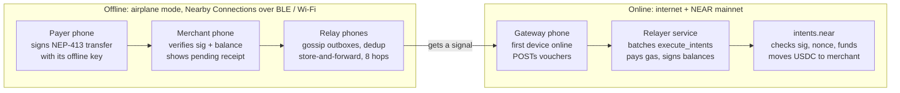

# NearBy — Build Plan & Spec

Local copy of the living spec at https://claude.ai/artifact/WL5vbTkHi7PiMb4KZXe9Yv (rev 28, copied 2026-11-06). If the two differ, the living spec is newer unless this file says otherwise.

**This file is newer on the nonce format (2026-11-06).** The contract source and mainnet `simulate_intents` show the salt applies only to nonces that start with `5628f6c6`. We sign plain 32-byte random nonces, so there is no salt to fetch or go stale. The living spec still describes a salted nonce. The places where this file differs from it are: "Why only on NEAR" item 1, the voucher's `nonce` line, "Parallel nonces" and "Nonce layouts", the Gate 1 paragraph under Schedule, and the first two rows plus the settlement row of the risk table.

**This file is newer on the payment request (2026-11-06).** A request carries a random `id` that the payer signs into the memo as `req:<id>` (steps 3 and 4). Without it, a voucher arriving over the mesh cannot be told apart from another customer's payment of the same amount. Mainnet `simulate_intents` accepts such memos.

We ship a Flutter app that pays with no internet. The payer signs a NEAR transfer on the phone, nearby phones relay it hop by hop over Bluetooth, and the first phone with a signal settles it on NEAR. Deadline: Nov 14, 23:59 UTC, 9 days from today.

## Overview

**Problem.** Card terminals and wallets stop working when the network does: rural markets, festivals, subways, outages, disasters. Cash is the only fallback today.

**Pitch.** NearBy: "Pay anyone nearby, even with no signal." Two phones tap or come near each other, the payment is signed and checked offline, and it reaches the chain later through a store-and-forward mesh.

**Tracks.** Real-World Money is the main one, Open Innovation the backup. Settling through NEAR Intents also fits NEAR's chain-abstraction story: the payee can cash out to any asset Intents supports.

**Competition.** As of the Nov 5 check, none of the 131 submissions do offline or mesh payments. The closest prior art is LOKA Pay (Bluetooth mesh on Solana, a Hacklanta II winner, Oct 2026). Our angles against it: NEAR-native keys, Intents settlement with cash-out to any chain, and a stated double-spend model.

**Scope for the demo.** The README claims only what runs, because AI screeners check every entry "runs and does what the README says" ([rules](https://nearhackathon.com/HACKATHON.md), Q-017).

| Must work by Nov 14 | Roadmap (labelled as such) |
| --- | --- |
| Offline sign → merchant verifies → 1–2 hops to a gateway → settles on `intents.near` mainnet | Long hop chains, background sync, battery tuning |
| Double-spend rejected offline (attested balance + seen vouchers) | Encryption in transit |
| Equivocation proof slashes a bond on chain | iOS, StrongBox key attestation |
| 3 Android phones, live mainnet tx links | Cash-out to other chains through Intents |

**Builder background.** Dastan has built a mesh network and an offline messenger before; the README says so in two sentences, as the reason the design scales past the demo.

## Why only on NEAR

Three properties make offline settlement work on NEAR and break it elsewhere; they go on one pitch slide.

1. **Unordered nonces.** An Intents nonce is 32 random bytes, so a phone signs any number of payments offline and they settle in any order. Ethereum nonces must increase one by one; Solana transactions expire with their recent blockhash in about a minute.
2. **An account from a key.** A NEAR implicit account is the hex of its ed25519 public key: the offline wallet exists with no transaction, fee or server.
3. **Signed messages, not transactions.** NEP-413 intents can be submitted by anyone who holds them, so the payer needs no gas token and the relayer holds no special power.

Also worth a line each in the README: merchants cash out to other chains through Intents, `deadline` expires stale vouchers in the protocol, `cafe.near` is readable on a QR code, and `env::ed25519_verify` makes the bond contract cheap.

## Architecture

A payment signed offline settles at the first phone with a signal (3 offline hops, 3 online steps).



The phones in the offline zone never need the internet. The merchant trusts the voucher because of the payer's signature and a relayer-signed balance attestation cached at top-up. The relayer is optional: any gateway can call `execute_intents` itself.

## Payment flow

The voucher is a standard NEAR Intents `transfer` intent, signed with NEP-413. We don't need our own settlement contract: anyone holding the voucher can submit it to `intents.near`, and the signature alone authorizes the transfer ([intent types](https://docs.near-intents.org/integration/verifier-contract/intent-types-and-execution), [signing](https://docs.near-intents.org/integration/verifier-contract/signing-intents)).

1. **Top up (online, once).** The app creates an offline ed25519 key held only on the phone. Its implicit account (the hex of the key) needs no `add_public_key`. The user locks a bond in the NearBy bond contract and funds the same account inside `intents.near` with `ft_transfer_call`, in USDC. That deposit is the offline budget.
2. **Refresh credential (online).** The relayer signs a balance attestation `{account, token, balance, bond, as_of}`, valid 24 h. The app caches it; merchants check it against the relayer key pinned in the app.
3. **Pay (offline).** The merchant shows a QR code with `{receiver_id, amount, token, id}`, where `id` is random per request. The payer signs the intent with a random nonce, a 72 h deadline, the request id (memo entry `req:<id>`) and the next sequence number, then sends the voucher over Nearby Connections (QR as a fallback).
4. **Verify (offline).** The merchant checks the signature, that the voucher names the request on screen, that `signer_id` matches the key, the deadline, the nonce, the sequence chain, and the attested balance minus vouchers already seen from this payer. If all pass: "Paid, pending settlement".
5. **Relay (offline, store-and-forward).** Every phone keeps an outbox. When two phones connect, they swap voucher hashes and send what the other lacks; each voucher carries a hop count that stops at 8. A phone carries its outbox until it meets someone.
6. **Settle (first phone online).** Any phone with a signal POSTs its outbox to the relayer, which calls `execute_intents` on `intents.near` and pays gas. If the relayer finds two vouchers with the same signer and sequence number, it also submits the pair to the bond contract.
7. **Confirm.** The relayer returns tx hashes; gateways gossip a signed `settled{voucher_hash, tx}` back into the mesh.

**Voucher on the wire** (the NEP-413 signed object; field names come from the Intents docs):

```json
{
  "standard": "nep413",
  "payload": {
    "recipient": "intents.near",
    "nonce": "<base64, 32 random bytes, not starting with 5628f6c6>",
    "message": "{\"signer_id\":\"<payer implicit hex>\",\"deadline\":\"2026-11-12T10:00:00Z\",\"intents\":[{\"intent\":\"transfer\",\"receiver_id\":\"merchant.near\",\"tokens\":{\"nep141:<usdc contract>\":\"2500000\"},\"memo\":\"seq:17 prev:<hash>\"}]}"
  },
  "public_key": "ed25519:<base58>",
  "signature": "ed25519:<base58>"
}
```

The memo carries a per-payer sequence number and the previous voucher's hash. Only the apps check that chain, to detect double-spending (see the next section). It never forces vouchers to settle in order.

**Parallel nonces.** Intents nonces are unordered: any 32 bytes not yet used by that account. A payer can sign many vouchers offline in parallel, and each settles on its own, in any order. Plain NEAR transactions can't do this, because an access key's nonce must strictly increase.

**Nonce layouts.** `intents.near` has two (`contracts/defuse/core/src/engine/mod.rs` in [near/intents](https://github.com/near/intents), `verify_intent_nonce`). A nonce starting with `5628f6c6` is *versioned*: prefix, version byte, 4-byte salt, 8-byte deadline, 15 random bytes. The salt must be in the contract's registry and the nonce deadline must be at or after the intent deadline. Any other 32 bytes are a plain nonce with no extra checks. We sign plain nonces, and the payee refuses versioned ones because it cannot check a salt or registry offline.

## Security and double-spend model

Offline double-spending can't be prevented, only bounded, proven and punished. We say so plainly and show all three layers working in the demo. Cheating costs the payer their bond and their key, for a gain capped at pocket-money size.

| Layer | Mechanism | Where | Status |
| --- | --- | --- | --- |
| 1. Bound | Offline key controls only the offline budget; per-payment cap (e.g. 25 USDC); merchant accepts at most attested balance minus vouchers seen from that payer; attestation expires after 24 h; any merchant with a signal checks live with `simulate_intents` | App + relayer | Must have |
| 2. Prove | Memo carries the payer's sequence number and the previous voucher's hash. Two valid vouchers with the same sequence number = a self-contained proof of cheating, checkable by anyone | App | Must have |
| 3. Punish | Bond contract: the payer locks a bond equal to the budget. Anyone submits two equivocating vouchers; the contract recomputes both NEP-413 hashes, checks both signatures with `env::ed25519_verify`, pays the bond to the cheated merchant and bans the key | Rust contract | Must have (1 day) |
| Hardening | Offline key generated in Android StrongBox; relayer attests only hardware-held keys | App + relayer | Stretch |

Protocol guards we get for free: NEP-413 `recipient` = `intents.near` blocks replay on other contracts, a nonce can never be reused per signer, and `deadline` expires old vouchers. Honest vouchers still settle through `intents.near`; the bond contract only sees disputes.

**Known limit.** A payer who cheats many merchants in one afternoon can take more than the bond. The per-payment cap and the balance-minus-seen rule keep that small, and the ban makes it a one-time loss per key.

## Tech stack and packages

The mesh is our own: a gossip layer of about 300 lines of Dart on top of Android's Nearby Connections, which handles discovery, BLE/Wi-Fi switching and multi-peer links. It sits behind a small `Transport` interface, so a raw-BLE or qaul backend can be swapped in later. Building it ourselves takes the same 2–3 days as embedding libqaul, has no unknown APIs, keeps every line judged as our work, and avoids AGPL, so the repo is MIT.

| Layer | Choice | Notes |
| --- | --- | --- |
| App | Flutter (Dart), Android | iOS on the roadmap |
| Transport | [nearby_connections](https://pub.dev/packages/nearby_connections) 4.3.0 | Android-only plugin; cluster strategy for many-to-many ([strategies](https://developers.google.com/nearby/connections/strategies)) |
| Gossip layer | Our Dart code behind a `Transport` interface | Outbox, hash exchange on connect, dedup, hop limit 8 |
| Hand-off fallback | QR (mobile_scanner + qr_flutter) | Works with every radio off |
| Signing | `cryptography` (Ed25519), `crypto` (SHA-256), base58 | NEP-413; byte-identical to the TS reference (tested) |
| Local store | sqflite | Outbox, seen vouchers, receipts, attestation |
| Relayer | TypeScript + near-api-js, Fastify | `execute_intents`, balance attestations, equivocation detection |
| Settlement | `intents.near`, mainnet only ([no testnet](https://docs.near-intents.org/integration/verifier-contract/introduction)) | Transfer intents; deposits via `ft_transfer_call` |
| Bond contract | Rust, near-sdk | Bonds, equivocation proofs, slashing, key bans |
| License | MIT | Rules accept any license (Q-014) |

## Schedule

Prove settlement by Nov 6, submit Nov 14 with 12 h spare. Build plan by day, 2026; bold rows are go / no-go gates.

| Date | Work |
| --- | --- |
| Nov 5 | Spec, repo, NEAR accounts |
| Nov 6 | **Gate 1: offline intent settles** |
| Nov 6–7 | Voucher + QR pay / verify |
| Nov 8–9 | Nearby transport + gossip layer |
| Nov 9 | **Cut line: mesh or QR-only** |
| Nov 10 | Gateway upload + relayer |
| Nov 11 | Double-spend guards |
| Nov 12 | Bond contract + slashing |
| Nov 13 | Demo video, README, APK |
| Nov 14 | **Submit (12:00 UTC)** |

Gate 1 comes first: a voucher signed on a phone in airplane mode, submitted later, has to settle on `intents.near`. The salt half of this gate is answered (plain nonces carry none); what remains is one funded run of `npm run settle-test`, signed now and submitted a day later. If that fails, settlement moves into our bond contract the same day. If the gossip layer isn't reliable by the end of Nov 9, the demo ships single-hop plus QR and multi-hop moves to the roadmap column. The bond contract takes Nov 12.

## Demo script and submission checklist

The video is 2 minutes, filmed with three phones: Payer (A), Merchant (B) and Gateway (C).

1. 0:00. The hook: "No signal? You can still pay." A and B go into airplane mode on camera.
2. 0:15. A pays B 2.50 USDC; B's receipt shows "Paid, pending settlement".
3. 0:40. B walks to C. The voucher hops B → C; C's mesh view shows it arrive.
4. 0:55. C turns on data and the voucher settles. Cut to the NEAR explorer tx on `intents.near`.
5. 1:10. A tries to spend the same funds at B again. B rejects it offline: "insufficient attested balance".
6. 1:25. A cheats a second merchant D with a reused sequence number. When it reaches the relayer, the bond contract slashes A's bond to D. Explorer tx on screen.
7. 1:45. "Why only on NEAR" slide, then the line: "NearBy: pay anyone nearby, even with no signal."

**Checklist**

- [ ] Public GitHub repo by Nov 14, 23:59 UTC, with an MIT LICENSE file (Q-014)
- [ ] README: problem, architecture, how to run, threat model, a "What works / What's next" table that matches the build exactly
- [ ] README lists every library used (Q-005) and the builder background paragraph
- [ ] Any code reused from Dastan's earlier mesh or messenger lands in one marked baseline commit or tag, with the README linking the hackathon diff (Q-003, Q-005)
- [ ] Demo video under 3 minutes, and an X post with it as the demo_url
- [ ] Signed APK on GitHub releases, so screeners can run it
- [ ] Mainnet tx links: one settlement, one slash
- [ ] Tracks: Real-World Money + Open Innovation
- [ ] Submitted on nearhackathon.com by Nov 14, 12:00 UTC (12 h buffer)

## Risks and open questions

| Risk | Impact | Fallback |
| --- | --- | --- |
| ~~The nonce's salt goes stale~~ Resolved 2026-11-06: plain nonces carry no salt (mainnet accepts one with a bogus salt prefix). For versioned nonces, old salts stay valid until the contract's DAO or salt manager invalidates them; there is no time-based expiry | Low: a contract upgrade could stop accepting plain nonces | Switch the signers to the versioned layout and cache `current_salt` at top-up |
| ~~`deadline` enforcement isn't documented~~ Confirmed 2026-11-06: mainnet rejects a past deadline ("deadline has expired") and a deadline without a time zone | None | — |
| No voucher has settled yet: checks so far are `simulate_intents` with an unfunded key | High until done | `npm run settle-test` with a funded offline account, signed now and submitted a day later. If it fails → settle through the bond contract |
| Nearby Connections drops links or rediscovers slowly | Medium | Single hop plus QR; record the demo in a quiet RF space |
| Bond contract slips past Nov 12 | Medium: weakens the double-spend story | Demo the offline proof (layer 2) and show the contract in tests |
| README claims more than runs | High: fails AI screening | Update the works/next table on the last day against the APK |
| Exact `execute_intents` and `simulate_intents` argument shapes | Low: `{ "signed": [voucher] }` works for `simulate_intents` on mainnet | Verifier Rust docs; test with a few cents |

**Open questions**

- [ ] Who pays gas long-term: a relayer fee per voucher, or a sponsor?
- [ ] USDC or wNEAR for the demo?
- [ ] Which parts of the earlier mesh or messenger code, if any, come in as baseline?
- [ ] Bond size: equal to the budget, or a multiple of the per-payment cap?

## Sources

- [NEAR Hackathon rules (HACKATHON.md)](https://nearhackathon.com/HACKATHON.md)
- [NEAR Intents: intent types and execution](https://docs.near-intents.org/integration/verifier-contract/intent-types-and-execution)
- [NEAR Intents: signing intents](https://docs.near-intents.org/integration/verifier-contract/signing-intents)
- [NEAR Intents: verifier introduction](https://docs.near-intents.org/integration/verifier-contract/introduction)
- [NEAR Intents: deposits](https://docs.near-intents.org/integration/verifier-contract/deposits-and-withdrawals/deposits)
- [nearby_connections on pub.dev](https://pub.dev/packages/nearby_connections)
- [NEAR Hackathon projects API](https://nearhackathon.com/api/projects?page=1)
