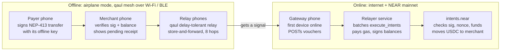

# NearBy — Build Plan & Spec

Local copy of the living spec at https://claude.ai/artifact/WL5vbTkHi7PiMb4KZXe9Yv (rev 25, copied 2026-11-05). If the two differ, the living spec is newer unless this file says otherwise.

**This file is newer on the nonce format (2026-11-06).** The contract source and mainnet `simulate_intents` show the salt applies only to nonces that start with `5628f6c6`. We sign plain 32-byte random nonces, so there is no salt to fetch or go stale. See "Parallel nonces" and the first two rows of the risk table.

We ship a Flutter app that pays with no internet. The payer signs a NEAR transfer on the phone, nearby phones relay it hop by hop over Bluetooth, and the first phone with a signal settles it on NEAR. Deadline: Nov 14, 23:59 UTC, 9 days from today.

## Overview

**Problem.** Card terminals and wallets stop working when the network does: rural markets, festivals, subways, outages, disasters. Cash is the only fallback today.

**Pitch.** NearBy: "Pay anyone nearby, even with no signal." Two phones tap or come near each other, the payment is signed and checked offline, and it reaches the chain later through a store-and-forward mesh.

**Tracks.** Real-World Money is the main one, Open Innovation the backup. Settling through NEAR Intents also fits NEAR's chain-abstraction story: the payee can cash out to any asset Intents supports.

**Competition.** As of the Nov 5 check, none of the 131 submissions do offline or mesh payments. The closest prior art is LOKA Pay (Bluetooth mesh on Solana, a Hacklanta II winner, Oct 2026). Our angles against it: NEAR-native keys, Intents settlement with cash-out to any chain, and a stated double-spend model.

**Scope for the demo.** Two to three Android phones in airplane mode, one gateway phone with a signal, a live payment that lands on NEAR mainnet in the explorer (Intents has no testnet, so the demo uses a few cents of USDC).

## Architecture

A payment signed offline settles at the first phone with a signal (3 offline hops, 3 online steps).



The phones in the offline zone never need the internet. The merchant trusts the voucher because of the payer's signature and a relayer-signed balance attestation cached at top-up. The relayer is optional: any gateway can call `execute_intents` itself.

## Payment flow

The voucher is a standard NEAR Intents `transfer` intent, signed with NEP-413. We don't need our own settlement contract: anyone holding the voucher can submit it to `intents.near`, and the signature alone authorizes the transfer ([intent types](https://docs.near-intents.org/integration/verifier-contract/intent-types-and-execution), [signing](https://docs.near-intents.org/integration/verifier-contract/signing-intents)).

1. **Top up (online, once).** The app creates an offline spending key, an ed25519 key held only on the phone. Its NEAR *implicit account* is the hex of that key, so no `add_public_key` call is needed. The user then funds that account's balance inside `intents.near` with `ft_transfer_call`, in USDC or wNEAR. That deposit is the offline budget.
2. **Refresh credential (online).** Our relayer signs a short balance attestation: `{account, token, balance, as_of}`. The app caches it, and the payee checks it against the relayer key pinned in the app.
3. **Pay (offline).** The payee shows a QR code or a qaul payment request with `{receiver_id, amount, token}`. The payer builds the intent message, picks a nonce and a deadline (now + 72 h), signs it, and hands the voucher over by qaul, or by QR as a fallback.
4. **Verify (offline).** The payee checks the ed25519 signature, that `signer_id` matches the public key (implicit account), the attestation's balance minus vouchers already seen from this payer, the deadline, and that the nonce hasn't been seen before. If all pass, the app shows a "Paid, pending settlement" receipt.
5. **Relay (offline, store-and-forward).** The merchant keeps a copy. The payer's app sends the voucher as a qaul delay-tolerant message to the relayer's qaul ID; qaul carries it hop by hop until some path reaches the relayer's internet node.
6. **Settle (first phone online).** Any phone with a signal POSTs the vouchers to the relayer. The relayer batches them into `execute_intents` on `intents.near` and pays the gas.
7. **Confirm.** The relayer returns the tx hash, and gateways gossip a signed `settled{voucher_hash, tx}` back into the mesh. The payee can later withdraw or swap to any chain through Intents (a stretch goal).

**Voucher on the wire** (the NEP-413 signed object; field names come from the Intents docs):

```json
{
  "standard": "nep413",
  "payload": {
    "recipient": "intents.near",
    "nonce": "<base64, 32 random bytes, not starting with 5628f6c6>",
    "message": "{\"signer_id\":\"<payer implicit hex>\",\"deadline\":\"2026-11-12T10:00:00Z\",\"intents\":[{\"intent\":\"transfer\",\"receiver_id\":\"merchant.near\",\"tokens\":{\"nep141:<usdc contract>\":\"2500000\"},\"memo\":\"seq:17 prev:<hash>\"}]}"
  },
  "public_key": "ed25519:<base58>",
  "signature": "ed25519:<base58>"
}
```

The memo carries a per-payer sequence number and the previous voucher's hash. Only the apps check that chain, to detect double-spending (see the next section). It never forces vouchers to settle in order.

**Parallel nonces.** Intents nonces are unordered: any 32 bytes not yet used by that account. A payer can sign many vouchers offline in parallel, and each settles on its own, in any order. Plain NEAR transactions can't do this, because an access key's nonce must strictly increase.

**Nonce layouts.** `intents.near` has two (`contracts/defuse/core/src/engine/mod.rs` in [near/intents](https://github.com/near/intents), `verify_intent_nonce`). A nonce starting with `5628f6c6` is *versioned*: prefix, version byte, 4-byte salt, 8-byte deadline, 15 random bytes. The salt must be in the contract's registry and the nonce deadline must be at or after the intent deadline. Any other 32 bytes are a plain nonce with no extra checks. We sign plain nonces, and the payee refuses versioned ones because it cannot check a salt or registry offline.

## Security and double-spend model

Offline double-spending can't be prevented, only bounded and detected. We say that plainly in the pitch and show the guards. On chain, `intents.near` settles vouchers in the order it receives them. Once the balance runs out, later vouchers fail.

| Threat | Guard | Where |
| --- | --- | --- |
| Payer signs more than they hold | Payee checks the attestation balance minus vouchers already seen from that payer; per-payment cap (e.g. 25 USDC); total offline budget = the deposit only | App |
| Same funds paid to two merchants who never meet | Sequence number + prev-hash chain in the memo. Two vouchers with the same seq = proof of equivocation, gossiped and flagged | App + relayer |
| Stale balance attestation | Attestation expires after 24 h; risk grows with age, and the UI warns | App |
| Replay on another contract | NEP-413 `recipient` = `intents.near` | Protocol |
| Replay of the same voucher | Unique nonce per signer, enforced on chain | Protocol |
| Old vouchers settling much later | `deadline` = now + 72 h | Protocol |
| Phone stolen | Offline key holds only the offline budget; the main wallet key never leaves the main wallet. Biometric unlock to sign | App |
| Relayer censors or drops vouchers | Any gateway can submit `execute_intents` directly; the relayer is a convenience | Design |

**Stretch: bonded payers.** A small contract of our own holds a bond per payer. Submitting two equivocating vouchers slashes the bond to the cheated merchant. That turns "detected" into "compensated".

## Tech stack and packages

The mesh is [qaul](https://qaul.net): a Rust core (libqaul) with a Flutter UI. It does peer-to-peer messaging over local Wi-Fi and BLE, with delay-tolerant delivery, so we don't build our own mesh. Its `qauld` daemon can run on a server as an internet-connected community node; the relayer runs one.

| Layer | Choice | Notes |
| --- | --- | --- |
| App | Flutter (Dart), Android first | Fork or embed qaul's Flutter UI + libqaul; our wallet screens on top |
| Mesh transport | [qaul](https://github.com/qaul/qaul.net) libqaul (Rust) | Wi-Fi + BLE, end-to-end encrypted, delay-tolerant ("send to users who are not currently connected"); AGPL-3.0, so our repo is AGPL too |
| Voucher delivery | qaul direct message to the relayer's qaul ID, plus a copy to the merchant | Any phone that later reaches the relayer's `qauld` node delivers it |
| Hand-off fallback | QR (mobile_scanner + qr_flutter) | Works with every radio off; good on stage |
| Signing | `cryptography` (Ed25519), `crypto` (SHA-256), base58 encoder | NEP-413: sign sha256(borsh(tag 2^31+413, payload)) |
| Local store | sqflite | Seen-vouchers, receipts, balance attestation |
| Relayer | TypeScript + near-api-js, plus `qauld` | Reads vouchers off qaul, calls `execute_intents`, signs balance attestations |
| Settlement | `intents.near` (mainnet only; [no testnet deployment](https://docs.near-intents.org/integration/verifier-contract/introduction)) | Transfer intents; deposits via `ft_transfer_call` |
| Optional contract | Rust, near-sdk | Only for the bonded-payer stretch, or as a fallback if old salts expire too fast |

## Schedule

Prove settlement by Nov 6, submit Nov 14 with 12 h spare. Build plan by day, 2026; bold rows are go / no-go gates.

| Date | Work |
| --- | --- |
| Nov 5 | Spec, repo, NEAR accounts |
| Nov 6 | **Gate 1: offline intent settles** |
| Nov 6–7 | Voucher + QR pay / verify |
| Nov 8–9 | libqaul integration in Flutter |
| Nov 9 | **Cut line: mesh or QR-only** |
| Nov 10 | Gateway upload + relayer |
| Nov 11 | Double-spend guards |
| Nov 12 | UI polish, cash-out stretch |
| Nov 13 | Demo video, README, APK |
| Nov 14 | **Submit (12:00 UTC)** |

Gate 1 is the riskiest step and comes first: a voucher signed on a phone in airplane mode, submitted later, has to settle on `intents.near`. If it fails on Nov 6, we switch to our own Rust settlement contract that day. If the mesh isn't reliable by the end of Nov 9, the demo ships single-hop qaul plus QR, and multi-hop becomes a recorded stretch.

## Demo script and submission checklist

The video is 2 minutes, filmed with three phones: Payer (A), Merchant (B) and Gateway (C).

1. 0:00. The hook: "No signal? You can still pay." A and B go into airplane mode on camera.
2. 0:15. A pays B 2.50 USDC by tapping near, with B's receipt on screen showing "Paid, pending settlement".
3. 0:45. B walks over to C. The voucher hops from B to C; C's mesh view shows it arrive.
4. 1:05. C turns on data, and the voucher settles. Cut to the NEAR explorer tx on `intents.near`.
5. 1:25. A tries to double-spend the same funds to B. B rejects it offline with "insufficient attested balance".
6. 1:45. Architecture slide and the closing line: "NearBy: pay anyone nearby, even with no signal. Settled on NEAR, cash out on any chain via Intents."

**Checklist**

- [ ] Public GitHub repo with a README: problem, architecture diagram, how to run, threat model
- [ ] Demo video under 3 minutes (YouTube or Loom)
- [ ] X post with the video, tagging the hackathon (most entries use an x.com post as their demo_url)
- [ ] Signed APK on GitHub releases
- [ ] Mainnet tx links from a real offline payment
- [ ] Tracks picked: Real-World Money + Open Innovation
- [ ] Submitted on nearhackathon.com by Nov 14, 12:00 UTC (12 h buffer)

## Risks and open questions

| Risk | Impact | Fallback |
| --- | --- | --- |
| ~~Salt in the nonce goes stale~~ Resolved 2026-11-06: plain nonces carry no salt (mainnet accepts one with a bogus salt prefix). For versioned nonces, old salts stay valid until the contract's DAO or salt manager invalidates them; there is no time-based expiry | Low: a contract upgrade could stop accepting plain nonces | Switch the signers to the versioned layout and cache `current_salt` at top-up |
| ~~`deadline` enforcement isn't documented~~ Confirmed 2026-11-06: mainnet rejects a past deadline ("deadline has expired") and a deadline without a time zone | None | — |
| No voucher has settled yet: checks so far are `simulate_intents` with an unfunded key | High until done | `npm run settle-test` with a funded offline account, signed now and submitted a day later |
| Integrating libqaul into our Flutter app (FFI, build setup) takes longer than planned | High: the solo time budget | Use qaul's own app as the transport and pass vouchers between apps by share intent; QR as the last resort |
| qaul's BLE path is less mature than Wi-Fi | Medium | Demo on a phone hotspot Wi-Fi with no internet uplink |
| Exact `execute_intents` argument shape | Low | Read the verifier Rust docs; copy from a known relayer |
| Judges question offline trust | Medium | Lead with the threat table and the double-spend demo |

**Open questions**

- [ ] Who pays gas long-term: a relayer fee taken from each voucher, or a sponsor?
- [ ] Is USDC the demo token, or wNEAR?
- [ ] Embed libqaul in our app, or fork qaul's Flutter app and add a wallet tab?

## Sources

- [NEAR Intents: intent types and execution](https://docs.near-intents.org/integration/verifier-contract/intent-types-and-execution)
- [NEAR Intents: signing intents](https://docs.near-intents.org/integration/verifier-contract/signing-intents)
- [NEAR Intents: deposits](https://docs.near-intents.org/integration/verifier-contract/deposits-and-withdrawals/deposits)
- [nearby_connections on pub.dev](https://pub.dev/packages/nearby_connections)
- [ble_peripheral on pub.dev](https://pub.dev/packages/ble_peripheral)
- [NEAR Hackathon projects API](https://nearhackathon.com/api/projects?page=1)
